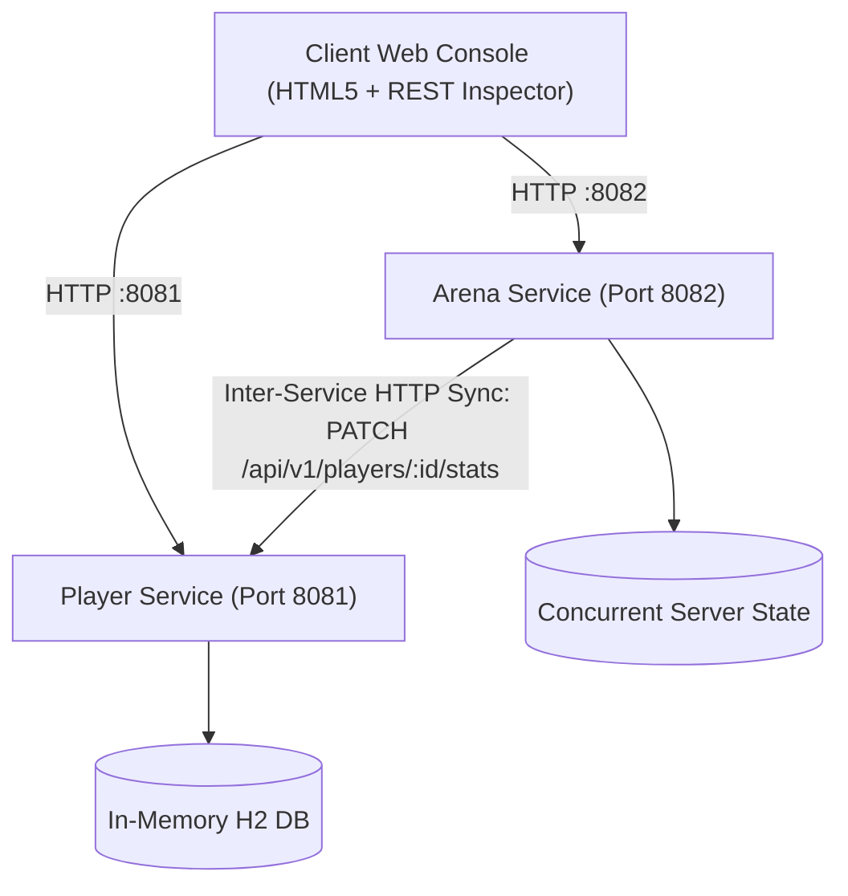

# Snake Arena: Clash of Serpents
### Distributed Microservices REST API & Real-Time Tactical Arena

Dokumentasi Tugas Mata Kuliah **Arsitektur Berbasis Layanan (ABL)**  
Fakultas Ilmu Komputer, Universitas Brawijaya  
Implementasi Arsitektur RESTful Microservices Terdistribusi dengan Game Engine Multi-Tenant Interaktif.

- **Penyusun:** Valentinus Marvel
- **NIM:** 245150201111027
- **Teknologi Utama:** Java 21/22, Spring Boot 3.2.5, Spring MVC, Springdoc OpenAPI 3 (Swagger UI), Spring Data JPA, JUnit 5, MockMvc, H2 Database, HTML5 Canvas, Web Audio API Synthesizer, Web Worker Heartbeat.

---

## 1. Arsitektur Sistem & Komponen Terdistribusi

Sistem mengadopsi arsitektur **Decoupled Microservices** yang memisahkan domain data pemain (*Identity & Persistence*) dengan simulasi komputasi arena (*Real-Time Match Engine*):



### 1.1 `player-service` (Port 8081)
- **Tanggung Jawab:** Manajemen identitas pemain, registrasi profil, persistensi skor akumulasi, dan histori pertandingan.
- **Database:** H2 In-Memory Database dengan Spring Data JPA.
- **Fitur Versioning:** Mengimplementasikan dua versi kontrak REST (`v1` dan `v2`) secara berdampingan. Versi 2 memberlakukan *breaking change* dengan skema payload tersarang (*nested DTO*).

### 1.2 `arena-service` (Port 8082)
- **Tanggung Jawab:** Server-authoritative match loop (tick 250ms), pergerakan koordinat serpent, deteksi tabrakan (PvP & self-collision), generator apel seimbang (maks 6 apel aktif), dan penegakan batas kapasitas (maks 16 pemain).
- **Static Host:** Melayani antarmuka web game pada root endpoint `http://localhost:8082/`.
- **Inter-Service Communication:** Menggunakan Spring `RestClient` untuk memanggil `player-service` saat sesi ular berakhir guna mencatat skor secara terdistribusi.

### 1.3 `frontend` (Tactical Cyber-Cockpit)
- **Tanggung Jawab:** Antarmuka visual web tanpa dependensi framework berat (Vanilla JS + CSS).
- **Fitur Unggulan:** 
  - Real-time HTTP Inspector log feed dengan visualisasi status HTTP dan payload JSON.
  - Dedicated Web Worker thread untuk background state polling dan heartbeat yang kebal terhadap *tab throttling* browser.
  - Web Audio API micro-synthesizer untuk umpan balik interaksi taktil percussive.

---

## 2. Spesifikasi Endpoint & Kontrak REST HTTP

Sistem mengimplementasikan standar kata kerja HTTP (**GET, POST, PUT, PATCH, DELETE**) secara semantik:

| Service | Method | Endpoint Path | Status Code | Deskripsi Fungsional |
|---|---|---|---|---|
| **Player** | `POST` | `/api/v1/players` | `201 Created` | Registrasi akun pemain baru versi flat DTO |
| **Player** | `POST` | `/api/v2/players` | `201 Created` / `400` | Registrasi akun versi 2 (wajib `classProfile`) |
| **Player** | `GET` | `/api/v1/players/{id}` | `200 OK` | Mengambil profil pemain versi 1 |
| **Player** | `GET` | `/api/v2/players/{id}` | `200 OK` | Mengambil profil pemain versi 2 |
| **Player** | `PUT` | `/api/v1/players/{id}` | `200 OK` | Pembaruan menyeluruh profil pemain |
| **Player** | `PATCH` | `/api/v1/players/{id}/stats` | `200 OK` | Pembaruan parsial statistik skor |
| **Player** | `DELETE` | `/api/v1/players/{id}` | `204 No Content` | Menghapus entitas akun pemain |
| **Arena** | `POST` | `/api/v1/arena/snakes` | `201 Created` | Deploy dan spawn serpent ke dalam arena |
| **Arena** | `GET` | `/api/v1/arena/state` | `200 OK` | Mengambil snapshot komprehensif dunia arena |
| **Arena** | `GET` | `/api/v1/arena/snakes/{id}` | `200 OK` | Mengambil telemetri kondisi serpent spesifik |
| **Arena** | `PUT` | `/api/v1/arena/snakes/{id}/loadout` | `200 OK` | Memperbarui kelas/skin serpent saat aktif |
| **Arena** | `PATCH` | `/api/v1/arena/snakes/{id}/eat` | `200 OK` | Perhitungan konsumsi apel dan poin |
| **Arena** | `PATCH` | `/api/v1/arena/snakes/{id}/skill` | `200 OK` | Mengaktifkan kemampuan spesifik kelas |
| **Arena** | `DELETE` | `/api/v1/arena/snakes/{id}` | `204 No Content` | Mengeluarkan serpent & memicu sinkronisasi skor |

---

## 3. Desain API Versioning & Breaking Changes

Untuk memenuhi studi kasus evolusi arsitektur layanan, `player-service` mendemonstrasikan transisi versi kontrak API:

### Kontrak Versi 1 (Flat Structure)
```json
POST /api/v1/players
Content-Type: application/json

{
  "username": "ViperAce",
  "snakeType": "VIPER",
  "speed": 12
}
```

### Kontrak Versi 2 (Hierarchical Nested Structure)
```json
POST /api/v2/players
Content-Type: application/json

{
  "username": "ViperAce",
  "classProfile": {
    "className": "VIPER",
    "passiveEffect": "Poison Trail",
    "activeAbility": {
      "name": "Venom Dash",
      "cooldownSeconds": 5,
      "speedMultiplier": 1.8
    }
  }
}
```

> **Verifikasi Breaking Change:**  
> Jika payload versi 1 dikirimkan ke endpoint `/api/v2/players`, server menolak permintaan dengan status code `400 Bad Request` sesuai spesifikasi RFC 9457 (Problem Details for HTTP APIs):
> ```json
> {
>   "type": "about:blank",
>   "title": "Bad Request",
>   "status": 400,
>   "detail": "Breaking change: payload v2 wajib memiliki objek 'classProfile'. Field lama 'snakeType' dan 'speed' sudah dihapus."
> }
> ```

---

## 4. Spesifikasi Kelas Serpent & Mekanika Arena

Tiga kelas serpent dirancang dengan karakteristik taktikal yang berbeda:

1. **CLASS 01 // VIPER (Agile Recon)**
   - *Passive:* Poison Trail. Kecepatan akselerasi dasar +20%.
   - *Active Ability:* Venom Dash. Akselerasi ledakan kecepatan tinggi selama 3 detik (cooldown 5 detik).
2. **CLASS 02 // PYTHON (Armored Tank)**
   - *Passive:* Thick Scales. Tahan benturan kontak badan serpent lawan.
   - *Active Ability:* Forcefield Shield. Perisai elektromagnetik pelindung dari eliminasi kontak tubuh.
3. **CLASS 03 // COBRA (Royal Specialist)**
   - *Passive:* Golden Touch. Memperoleh +50 poin dari Golden Apple (dibanding 30 poin kelas lain).
   - *Active Ability:* Golden Beacon. Mempercepat deteksi dan pemunculan apel emas di sekitar arena.

---

## 5. Dokumentasi Interaktif OpenAPI 3 (Swagger UI)

Spesifikasi antarmuka terintegrasi dengan Springdoc OpenAPI:

- **Player Service Swagger:** `http://localhost:8081/swagger-ui.html`
  - Menyediakan selektor dokumen untuk beralih antara definisi kontrak `v1-api` dan `v2-api`.
- **Arena Service Swagger:** `http://localhost:8082/swagger-ui.html`
  - Menyediakan eksplorasi langsung untuk endpoint simulasi arena dan status server.

---

## 6. Prosedur Pengujian Otomatis (Automated Test Suite)

Proyek dilengkapi dengan pengujian unit dan integrasi berbasis JUnit 5 dan MockMvc:

### Menjalankan Test Player Service:
```bash
cd player-service
./mvnw clean test
```
*Cakupan Pengujian:*
- Verifikasi seluruh kata kerja REST (`POST 201`, `GET 200`, `PUT 200`, `PATCH 200`, `DELETE 204`).
- Validasi skema v2 dan penolakan payload v1 (`400 Bad Request`).
- Validasi RFC 9457 exception handling.

### Menjalankan Test Arena Service:
```bash
cd arena-service
./mvnw clean test
```
*Cakupan Pengujian:*
- Siklus hidup serpent (Join, Snapshot State, Loadout, Eat Apple, Leave & Sync).
- Verifikasi mock inter-service HTTP client invocation (`PlayerServiceClient`).
- Uji isolasi tab/jendela independen dan Web Worker heartbeat.

---

## 7. Panduan Menjalankan Sistem Secara Lokal

### Prasyarat
- Java Development Kit (JDK) 21 atau lebih baru.
- Port 8081 dan 8082 dalam kondisi bebas.

### Langkah 1: Jalankan Player Service
```bash
cd player-service
./mvnw.cmd spring-boot:run
```
Service beroperasi pada `http://localhost:8081`.

### Langkah 2: Jalankan Arena Service
```bash
cd arena-service
./mvnw.cmd spring-boot:run
```
Service beroperasi pada `http://localhost:8082`.

### Langkah 3: Akses Antarmuka Game
Buka browser dan arahkan ke:
```
http://localhost:8082/
```

---

## 8. Struktur Repositori

```
snake-arena-microservices/
├── .github/
│   └── workflows/
│       └── ci.yml               # GitHub Actions CI Pipeline
├── player-service/              # Microservice Identity & Persistence (Port 8081)
│   ├── pom.xml
│   └── src/main/java/com/snake/playerservice/
│       ├── controller/          # PlayerControllerV1 & PlayerControllerV2
│       ├── domain/              # Entity & ClassProfile Records
│       ├── dto/                 # Request & Response Contracts
│       ├── repository/          # Spring Data JPA Repository
│       └── service/             # Business Logic Layer
├── arena-service/               # Microservice Real-Time Engine (Port 8082)
│   ├── pom.xml
│   └── src/main/java/com/snake/arenaservice/
│       ├── client/              # Inter-Service HTTP Client
│       ├── controller/          # ArenaController
│       ├── domain/              # World State, Snake, Apple
│       ├── service/             # ArenaManager Collision & Tick Loop
│       └── resources/static/    # Static Web UI & REST Inspector
├── frontend/
│   └── index.html               # Source Web Game Client
└── README.md
```
