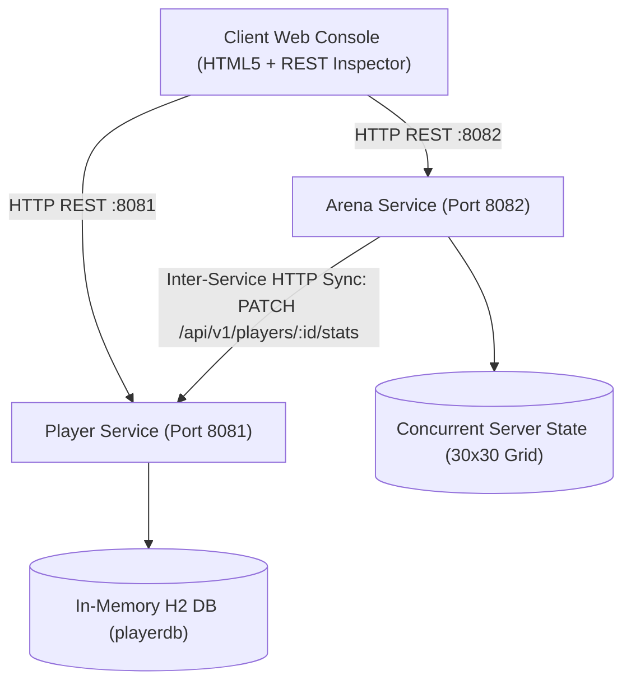

# Snake Arena: Clash of Serpents
### Distributed Microservices REST API & Real-Time Tactical Arena

[](https://adoptium.net/)
[](https://spring.io/projects/spring-boot)
[](https://www.docker.com/)
[](https://junit.org/junit5/)
[](https://swagger.io/specification/)
[](https://microservices.io/)

Dokumentasi Tugas Mata Kuliah **Arsitektur Berbasis Layanan (ABL)**  
Fakultas Ilmu Komputer, Universitas Brawijaya  
Implementasi Arsitektur RESTful Microservices Terdistribusi dengan Game Engine Multi-Tenant Interaktif.

---

### Tim Pengembang:
| No. | Nama Mahasiswa | NIM |
|:---:|:---|:---:|
| 1 | Valentinus Marvel | 245150201111027 |
| 2 | Muhammad Raditya Arsyad | 245150207111043 |
| 3 | Muhamad Fahmi Siddiq Aqsha | 245150200111030 |
| 4 | Dafid Rosydan Hanif | 245150200111029 |

- **Teknologi Utama:** Java 21 LTS, Spring Boot 3.2.5, Spring MVC, Springdoc OpenAPI 3 (Swagger UI), Spring Data JPA, Resilience4j Circuit Breaker, JUnit 5, MockMvc, H2 In-Memory Database, HTML5 Canvas, Web Audio API Synthesizer, Web Worker Heartbeat, Docker & Docker Compose.

---

## Daftar Isi
- [1. Arsitektur Sistem & Komponen Terdistribusi](#1-arsitektur-sistem--komponen-terdistribusi)
- [2. Spesifikasi Endpoint & Kontrak REST HTTP](#2-spesifikasi-endpoint--kontrak-rest-http)
- [3. Desain API Versioning & Breaking Changes (v1 vs v2)](#3-desain-api-versioning--breaking-changes-v1-vs-v2)
- [4. Spesifikasi Kelas Serpent & Mekanika Arena](#4-spesifikasi-kelas-serpent--mekanika-arena)
- [5. Dokumentasi Interaktif OpenAPI 3 & Swagger UI](#5-dokumentasi-interaktif-openapi-3--swagger-ui)
- [6. Prosedur Pengujian Otomatis (Automated Test Suite)](#6-prosedur-pengujian-otomatis-automated-test-suite)
- [7. Panduan Menjalankan Sistem Secara Lokal](#7-panduan-menjalankan-sistem-secara-lokal)
- [8. Pola Desain Microservices Enterprise yang Diterapkan](#8-pola-desain-microservices-enterprise-yang-diterapkan)
- [9. Struktur Repositori](#9-struktur-repositori)

---

## 1. Arsitektur Sistem & Komponen Terdistribusi

Sistem mengadopsi arsitektur **Decoupled Microservices** yang memisahkan domain data pemain (*Identity & Persistence*) dengan simulasi komputasi arena (*Real-Time Match Engine*):



### 1.1 `player-service` (Port 8081)
- **Tanggung Jawab:** Manajemen identitas pemain, registrasi profil, persistensi skor akumulasi, dan histori pertandingan.
- **Database:** H2 In-Memory Database (`jdbc:h2:mem:playerdb`) dengan Spring Data JPA.
- **Fitur Versioning:** Mengimplementasikan dua versi kontrak REST (`v1` flat structure dan `v2` modern RPG nested structure) secara berdampingan. Versi 2 memberlakukan *breaking change* dengan skema payload tersarang (*nested DTO*), kalkulasi kecepatan dinamis berdasarkan kelas, dan validasi RFC 7807 / RFC 9457.

### 1.2 `arena-service` (Port 8082)
- **Tanggung Jawab:** Server-authoritative match loop (**tick 120ms**), pergerakan koordinat serpent, deteksi tabrakan (PvP & self-collision), generator apel seimbang (maks 6 apel aktif), dan penegakan batas kapasitas (maks 16 pemain).
- **Static Host:** Melayani antarmuka web game pada root endpoint `http://localhost:8082/`.
- **Inter-Service Communication:** Menggunakan Spring `RestClient` yang dilindungi **Resilience4j Circuit Breaker** (`@CircuitBreaker`) untuk memanggil `player-service` saat sesi ular berakhir guna mencatat skor secara terdistribusi.

### 1.3 `frontend` (Tactical Cyber-Cockpit)
- **Tanggung Jawab:** Antarmuka visual web tanpa dependensi framework berat (Vanilla JS + CSS).
- **Fitur Unggulan:** 
  - Real-time HTTP Inspector log feed dengan visualisasi status HTTP dan payload JSON.
  - Dedicated Web Worker thread untuk background state polling dan heartbeat yang kebal terhadap *tab throttling* browser.
  - Web Audio API micro-synthesizer untuk umpan balik interaksi taktil percussive.
  - Skema identitas unik Tag Discriminator (`Callsign#XXXX`) untuk mencegah bentrok multi-tab pada nama yang sama.

---

## 2. Spesifikasi Endpoint & Kontrak REST HTTP

Sistem mengimplementasikan standar kata kerja HTTP (**GET, POST, PUT, PATCH, DELETE**) secara semantik:

| Service | Method | Endpoint Path | Status Code | Deskripsi Fungsional |
|---|---|---|---|---|
| **Player** | `POST` | `/api/v1/players` | `201 Created` | Registrasi akun pemain baru versi flat DTO |
| **Player** | `POST` | `/api/v2/players` | `201 Created` / `400` | Registrasi akun versi 2 (wajib `classProfile`) |
| **Player** | `GET` | `/api/v1/players` | `200 OK` | Mengambil seluruh daftar pemain v1 |
| **Player** | `GET` | `/api/v2/players` | `200 OK` | Mengambil seluruh daftar pemain v2 |
| **Player** | `GET` | `/api/v1/players/{id}` | `200 OK` | Mengambil profil pemain versi 1 berdasarkan ID |
| **Player** | `GET` | `/api/v2/players/{id}` | `200 OK` | Mengambil profil pemain versi 2 berdasarkan ID |
| **Player** | `PUT` | `/api/v1/players/{id}` | `200 OK` | Pembaruan menyeluruh profil pemain v1 |
| **Player** | `PUT` | `/api/v2/players/{id}` | `200 OK` | Pembaruan menyeluruh profil pemain v2 |
| **Player** | `PATCH` | `/api/v1/players/{id}/stats` | `200 OK` | Pembaruan parsial statistik skor v1 |
| **Player** | `PATCH` | `/api/v2/players/{id}/stats` | `200 OK` | Pembaruan parsial statistik skor v2 |
| **Player** | `DELETE` | `/api/v1/players/{id}` | `204 No Content` | Menghapus entitas akun pemain v1 |
| **Player** | `DELETE` | `/api/v2/players/{id}` | `204 No Content` | Menghapus entitas akun pemain v2 |
| **Arena** | `POST` | `/api/v1/arena/snakes` | `201 Created` | Deploy dan spawn serpent ke dalam arena |
| **Arena** | `GET` | `/api/v1/arena/state` | `200 OK` | Mengambil snapshot komprehensif dunia arena (grid, apel, ular) |
| **Arena** | `GET` | `/api/v1/arena/snakes/{id}` | `200 OK` | Mengambil telemetri kondisi serpent spesifik |
| **Arena** | `PUT` | `/api/v1/arena/snakes/{id}/loadout` | `200 OK` | Memperbarui kelas/skin serpent saat aktif di arena |
| **Arena** | `PATCH` | `/api/v1/arena/snakes/{id}/direction` | `200 OK` | Memperbarui arah pergerakan ular (UP, DOWN, LEFT, RIGHT) |
| **Arena** | `PATCH` | `/api/v1/arena/snakes/{id}/eat` | `200 OK` | Perhitungan konsumsi apel dan poin |
| **Arena** | `PATCH` | `/api/v1/arena/snakes/{id}/skill` | `200 OK` | Mengaktifkan kemampuan spesifik kelas |
| **Arena** | `PATCH` | `/api/v1/arena/snakes/{id}/heartbeat`| `200 OK` | Memperbarui sinyal detak aktif mencegah watchdog timeout 7s |
| **Arena** | `DELETE` | `/api/v1/arena/snakes/{id}` | `204 No Content` | Mengeluarkan serpent & memicu sinkronisasi skor via Circuit Breaker |
| **Arena** | `POST` | `/api/v1/arena/snakes/{id}/leave` | `200 OK` | Mengeluarkan serpent via browser `navigator.sendBeacon` saat tab ditutup |

---

## 3. Desain API Versioning & Breaking Changes (v1 vs v2)

Untuk memenuhi studi kasus evolusi arsitektur layanan, `player-service` mendemonstrasikan transisi versi kontrak API:

### Kontrak Versi 1 (Flat Structure)
```json
POST /api/v1/players
Content-Type: application/json

{
  "username": "ViperAce",
  "snakeType": "VIPER"
}
```

### Kontrak Versi 2 (Hierarchical Nested Structure)
```json
POST /api/v2/players
Content-Type: application/json

{
  "username": "ViperAce",
  "classProfile": {
    "className": "VIPER",
    "passiveEffect": "POISON_TRAIL",
    "activeAbility": {
      "name": "VENOM_DASH",
      "cooldownSeconds": 5,
      "speedMultiplier": 1.8
    }
  }
}
```

> **Verifikasi Breaking Change:**  
> Jika payload versi 1 dikirimkan ke endpoint `/api/v2/players`, server menolak permintaan dengan status code `400 Bad Request` dan merespon dengan model seragam RFC 7807 / RFC 9457 (`HttpErrorInfo`):
> ```json
> {
>   "timestamp": "2026-11-22T01:10:00Z",
>   "path": "/api/v2/players",
>   "status": 400,
>   "error": "Bad Request",
>   "message": "Validation failed for object='playerV2Input'. Error count: 1",
>   "serviceAddress": "player-service/172.19.0.2:8081"
> }
> ```

---

## 4. Spesifikasi Kelas Serpent & Mekanika Arena

Tiga kelas serpent dirancang dengan karakteristik taktikal yang berbeda:

1. **CLASS 01 // VIPER (Agile Recon)**
   - *Base Speed:* 7 (Kecepatan tertinggi).
   - *Passive:* Poison Trail.
   - *Active Ability:* Venom Dash. Akselerasi ledakan kecepatan tinggi selama 3 detik (cooldown 5 detik).
2. **CLASS 02 // PYTHON (Armored Tank)**
   - *Base Speed:* 5 (Bobot terberat, pertahanan tinggi).
   - *Passive:* Thick Scales. Tahan benturan kontak badan serpent lawan.
   - *Active Ability:* Forcefield Shield. Perisai elektromagnetik pelindung dari eliminasi kontak tubuh.
3. **CLASS 03 // COBRA (Royal Specialist)**
   - *Base Speed:* 6 (Seimbang).
   - *Passive:* Golden Touch. Memperoleh +50 poin dari Golden Apple (dibanding 30 poin kelas lain).
   - *Active Ability:* Golden Beacon. Mempercepat deteksi dan pemunculan apel emas di sekitar arena.

---

## 5. Dokumentasi Interaktif OpenAPI 3 & Swagger UI

Spesifikasi antarmuka terintegrasi secara otomatis menggunakan Springdoc OpenAPI:

- **Player Service Swagger:** `http://localhost:8081/swagger-ui/index.html` (atau `http://localhost:8081/swagger-ui.html`)
  - Menyediakan selektor dokumen untuk beralih antara definisi kontrak `v1-api` dan `v2-api`.
- **Arena Service Swagger:** `http://localhost:8082/swagger-ui/index.html` (atau `http://localhost:8082/swagger-ui.html`)
  - Menyediakan eksplorasi langsung untuk endpoint simulasi arena dan status server.
- **Spesifikasi OpenAPI Resmi:** Berkas spesifikasi mandiri tersedia di direktori `docs/` (`openapi-v1-player-service.yaml` dan `openapi-v1-arena-service.yaml`).

---

## 6. Prosedur Pengujian Otomatis (Automated Test Suite)

Proyek dilengkapi dengan pengujian unit dan integrasi berbasis JUnit 5, MockMvc, dan Resilience4j Test Verification (**Total 48 Pengujian Lulus 100%**):

### Menjalankan Test Player Service (20 Tests):
```bash
cd player-service
./mvnw clean test
```
*Cakupan Pengujian:*
- `PlayerV1GetPostApiTests`: Pengujian endpoint GET dan POST v1 (BAB 5).
- `PlayerV1PutPatchDeleteApiTests`: Pengujian pembaruan profil PUT, patch skor PATCH, eliminasi DELETE, dan validasi RFC 7807 (BAB 6).
- `PlayerV2ApiTests`: Validasi ketat DTO v2, kalkulasi speed dinamis, penolakan flat payload v1, dan tiering RPG.

### Menjalankan Test Arena Service (28 Tests):
```bash
cd arena-service
./mvnw clean test
```
*Cakupan Pengujian:*
- `ArenaGetPostApiTests`: Pengujian spawn ular dan pengambilan kondisi arena (BAB 5).
- `ArenaPutPatchDeleteApiTests`: Pengujian update loadout skin, pergerakan arah real-time, konsumsi apel, aktivasi skill cooldown, eliminasi ular, dan sinkronisasi skor (BAB 6).
- `PlayerServiceClientTest`: Verifikasi ketahanan Resilience4j Circuit Breaker saat `player-service` mengalami downtime.

---

## 7. Panduan Menjalankan Sistem Secara Lokal

### Prasyarat
- Java Development Kit (JDK) 21 LTS atau lebih baru.
- Port 8081 dan 8082 dalam kondisi bebas.

### Opsi A: Menggunakan Docker Compose (Direkomendasikan)
Pastikan Docker Desktop / daemon Docker telah berjalan, lalu jalankan dari root repositori:

**Windows Command Prompt / PowerShell:**
```cmd
run_docker.bat
```
*Atau langsung via Docker CLI:*
```bash
docker compose up --build -d
```

**Linux / macOS / WSL:**
```bash
chmod +x run_docker.sh stop_docker.sh
./run_docker.sh
```

Untuk menghentikan seluruh kontainer:
```cmd
stop_docker.bat
```
*(atau `docker compose down`)*

### Opsi B: Menjalankan Secara Lokal (Maven Wrapper)

#### Langkah 1: Jalankan Player Service
```bash
cd player-service
./mvnw spring-boot:run
```
Service beroperasi pada `http://localhost:8081`.

#### Langkah 2: Jalankan Arena Service (pada Terminal Terpisah)
```bash
cd arena-service
./mvnw spring-boot:run
```
Service beroperasi pada `http://localhost:8082`.

### Langkah 3: Akses Antarmuka & Layanan (Localhost)
- **Web Game & Dasbor Pemantauan:** `http://localhost:8082/`
- **Swagger UI Player Service:** `http://localhost:8081/swagger-ui/index.html`
- **Swagger UI Arena Service:** `http://localhost:8082/swagger-ui/index.html`
- **Health Check Player Service:** `http://localhost:8081/actuator/health`
- **Health Check Arena Service:** `http://localhost:8082/actuator/health`

### Opsi C: Akses Demonstrasi Publik (API Gateway & Cloudflare Tunnel)

Bagi penguji yang ingin mendemonstrasikan sistem ke internet publik atau bermain multipemain lintas perangkat tanpa konfigurasi router atau IP publik:

1. **API Gateway (Nginx Reverse Proxy Port 8080):**
   Sistem menyediakan gerbang tunggal (*single port entrypoint*) pada port `8080` yang memetakan rute:
   - `/api/v1/players` -> Player Service (`localhost:8081`)
   - `/` dan `/api/v1/arena` -> Arena Service (`localhost:8082`)

2. **Ekspos Publik dengan Cloudflare Quick Tunnel (100% Gratis Tanpa Akun):**
   Jalankan Cloudflared Quick Tunnel yang mengarah ke port API Gateway:
   ```bash
   cloudflared tunnel --url http://localhost:8080
   ```
   Sistem akan menghasilkan URL publik HTTPS resmi (misalnya: `https://xxxx.trycloudflare.com`).

3. **Adaptive Origin Detection:**
   Klien web frontend (`frontend/js/api.js`) telah dilengkapi deteksi *origin* otomatis. Saat diakses via domain tunnel publik, frontend secara dinamis mengarahkan panggilan REST API ke domain gateway yang sama tanpa kendala CORS maupun *mixed-content*.

---

## 8. Pola Desain Microservices Enterprise yang Diterapkan

Mengacu pada tolak ukur buku *Microservices with Spring Boot and Spring Cloud (4th Edition)* (Magnus Larsson) dan *Mastering RESTful Web Services with Java*:

1. **Decompose by Business Capability:** Pemisahan domain profil & persistensi data (`player-service`) dari simulasi game engine real-time (`arena-service`).
2. **Database per Service:** `player-service` mengelola basis data SQL H2 JPA terisolasi, sementara `arena-service` mengelola state in-memory murni. Tidak ada basis data bersama (*zero cross-database access*).
3. **Containerization & Orchestration:** Multi-stage Dockerfile berbasis Eclipse Temurin JRE 21 dengan pengguna non-root (`appuser:1001`) dan orkestrasi `docker-compose.yml` pada bridge network `snake-network`.
4. **Observability & Health Probes:** Integrasi `spring-boot-starter-actuator` (`/actuator/health`) untuk *liveness* dan *readiness probe* kontainer.
5. **Standardized Error Handling:** Model response error seragam `HttpErrorInfo` (RFC 7807 / RFC 9457) yang menyertakan timestamp, HTTP status, pesan, dan `serviceAddress` (`hostname/ip:port`) dari mikroservis yang merespon.
6. **Resilience & Fault Tolerance:** Perlindungan komunikasi antar-layanan di `PlayerServiceClient` menggunakan **Resilience4j Circuit Breaker** (`@CircuitBreaker`). Jika `player-service` tidak dapat dijangkau, skor pertandingan diamankan di antrean lokal (*graceful fallback*) tanpa menghentikan jalannya arena game.
7. **Client-Side Concurrency Isolation:** Tag Discriminator 4-digit acak (`#XXXX`) pada frontend memastikan dua tab browser atau perangkat berbeda dengan nama dasar yang sama tetap beroperasi pada entitas independen.

---

## 9. Struktur Repositori

```
snake-arena-microservices/
├── .dockerignore
├── docker-compose.yml           # Orkestrasi kontainer Docker multi-service
├── run_docker.bat / .sh         # Skrip otomatisasi peluncuran kontainer
├── stop_docker.bat / .sh        # Skrip otomatisasi penghentian kontainer
├── docs/
│   ├── adr/                     # Architecture Decision Records (ADR 0001 - 0004)
│   ├── openapi-v1-player-service.yaml  # Spesifikasi OpenAPI Player Service
│   └── openapi-v1-arena-service.yaml   # Spesifikasi OpenAPI Arena Service
├── player-service/              # Microservice Identitas & Persistensi (Port 8081)
│   ├── Dockerfile               # Multi-stage production container build
│   ├── pom.xml                  # Actuator, Spring Data JPA, Web, Validation
│   └── src/
│       ├── main/java/com/snake/playerservice/
│       │   ├── controller/      # PlayerV1Controller & PlayerV2Controller
│       │   ├── domain/          # PlayerEntity & PlayerRepository (H2 JPA)
│       │   ├── dto/             # Request & Response Contracts, HttpErrorInfo
│       │   ├── exception/       # GlobalExceptionHandler (@RestControllerAdvice)
│       │   └── util/            # ServiceUtil (host & port discovery)
│       └── test/java/com/snake/playerservice/
│           ├── PlayerV1GetPostApiTests.java
│           ├── PlayerV1PutPatchDeleteApiTests.java
│           └── PlayerV2ApiTests.java
├── arena-service/               # Microservice Real-Time Game Engine (Port 8082)
│   ├── Dockerfile               # Multi-stage container with bundled static assets
│   ├── pom.xml                  # Actuator, Resilience4j, AOP, Web
│   └── src/
│       ├── main/java/com/snake/arenaservice/
│       │   ├── client/          # PlayerServiceClient (Resilience4j Circuit Breaker)
│       │   ├── controller/      # ArenaController
│       │   ├── domain/          # Snake, Apple, ArenaState
│       │   ├── dto/             # Input contracts, HttpErrorInfo
│       │   ├── exception/       # GlobalExceptionHandler
│       │   ├── service/         # ArenaManager Collision & Tick Loop (120ms)
│       │   └── resources/static/# Bundled Runtime Web UI & REST Inspector
│       └── test/java/com/snake/arenaservice/
│           ├── ArenaGetPostApiTests.java
│           ├── ArenaPutPatchDeleteApiTests.java
│           └── client/PlayerServiceClientTest.java
└── frontend/                    # Source Web Client (HTML5 Canvas, CSS, Vanilla JS)
```
