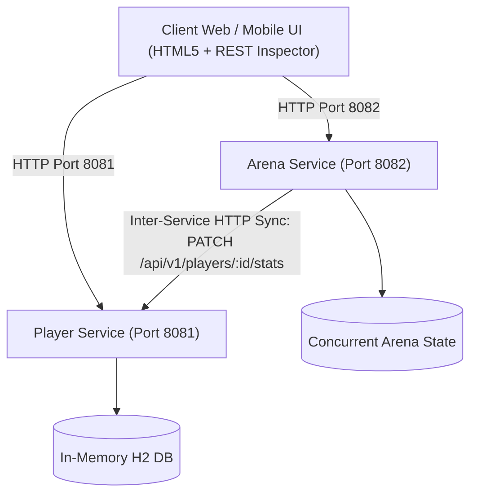

# Snake Arena: Clash of Serpents (Distributed Microservices REST API)

Proyek Tugas Mata Kuliah **Arsitektur Berbasis Layanan (ABL)**  
Implementasi Arsitektur RESTful Microservices Terdistribusi dengan Game Arena Interaktif.

- **Nama Mahasiswa:** Valentinus Marvel
- **NIM:** 245150201111027
- **Teknologi:** Java 21 / 22, Spring Boot 3.2.5, Spring MVC, Springdoc OpenAPI (Swagger 3), JUnit 5, H2 In-Memory DB, HTML5 Canvas, Vanilla CSS3 & JS.

---

## 🏛️ Arsitektur Sistem

Sistem mengadopsi arsitektur **Decoupled Microservices** yang terbagi menjadi dua service independen dan satu client antarmuka web game:



### 1. `player-service` (Port 8081)
- **Tanggung Jawab:** Manajemen identitas pemain, atribut kelas ular, catatan statistik pertandingan, dan histori skor tertinggi (high score).
- **Database:** H2 In-Memory Database dengan Spring Data JPA.
- **Fitur Khusus:** Penerapan **API Versioning (v1 dan v2)** dengan skema *Breaking Changes*.
  - `v1`: Struktur data datar (`snakeType`, `speed`).
  - `v2`: Memecah kompatibilitas lama dengan menghapus atribut flat dan mewajibkan objek `classProfile` tersarang (*nested*). Payload v1 akan ditolak dengan respons `400 Bad Request` (RFC 9457 ProblemDetail).

### 2. `arena-service` (Port 8082)
- **Tanggung Jawab:** Manajemen sesi pertempuran (*match session*), pergerakan ular, koordinat apel (*food spawn*), deteksi tabrakan (*collision*), live leaderboard, dan aktivasi skill kelas.
- **Static Web Host:** Melayani antarmuka game pada endpoint root `http://localhost:8082/`.
- **Inter-Service Communication:** Menggunakan Spring `RestClient` non-blocking untuk memanggil `player-service` secara asinkron saat ular tereliminasi/keluar guna menyinkronkan skor akhir.

### 3. `frontend`
- **Tanggung Jawab:** Web Client responsif (Desktop & Mobile) menggunakan HTML5 Canvas performa tinggi.
- **Fitur Unggulan:** **Live REST API Inspector HUD** yang menampilkan riwayat request, metode HTTP (`GET`, `POST`, `PUT`, `PATCH`, `DELETE`), payload JSON, response latency, dan status code secara real-time.

---

## 📡 Ringkasan Endpoint & Metode HTTP Lengkap

Sistem mengimplementasikan seluruh standar kata kerja HTTP (**GET, POST, PUT, PATCH, DELETE**):

| Service | Method | Endpoint | Deskripsi |
|---|---|---|---|
| **Player** | `POST` | `/api/v1/players` | Registrasi pemain baru versi 1 (`201 Created`) |
| **Player** | `POST` | `/api/v2/players` | Registrasi pemain baru versi 2 (`201 Created` / `400 Bad Request`) |
| **Player** | `GET` | `/api/v1/players/{id}` | Mengambil data profil pemain versi 1 |
| **Player** | `GET` | `/api/v2/players/{id}` | Mengambil data profil pemain versi 2 (`classProfile`) |
| **Player** | `PUT` | `/api/v1/players/{id}` | Memperbarui seluruh profil pemain secara menyeluruh |
| **Player** | `PATCH` | `/api/v1/players/{id}/stats` | Sinkronisasi skor dan match stats (digunakan oleh Arena Service) |
| **Player** | `DELETE` | `/api/v1/players/{id}` | Menghapus data akun pemain (`204 No Content`) |
| **Arena** | `POST` | `/api/v1/arena/snakes` | Pemain bergabung ke arena pertandingan (`201 Created`) |
| **Arena** | `GET` | `/api/v1/arena/state` | Mengambil snapshot arena (posisi semua ular, apel, bot) |
| **Arena** | `GET` | `/api/v1/arena/snakes/{id}` | Mengambil kondisi spesifik ular pemain |
| **Arena** | `PUT` | `/api/v1/arena/snakes/{id}/loadout` | Mengganti kelas/skin ular di arena secara real-time |
| **Arena** | `PATCH` | `/api/v1/arena/snakes/{id}/eat` | Memakan apel, menambah panjang badan dan skor |
| **Arena** | `PATCH` | `/api/v1/arena/snakes/{id}/skill` | Mengaktifkan/mematikan skill kelas ular |
| **Arena** | `DELETE` | `/api/v1/arena/snakes/{id}` | Keluar/mati di arena (`204 No Content` & inter-service sync) |

---

## ⚡ Implementasi API Versioning & Breaking Changes

Proyek ini mendemonstrasikan evolusi API perusahaan di mana versi 2 memperkenalkan perubahan struktur yang sengaja memutus kompatibilitas mundur (*breaking changes*):

### Payload Versi 1 (Datar / Flat)
```json
POST /api/v1/players
Content-Type: application/json

{
  "username": "Marvel",
  "snakeType": "VIPER",
  "speed": 12
}
```

### Payload Versi 2 (Objek Kelas Tersarang / Nested ClassProfile)
```json
POST /api/v2/players
Content-Type: application/json

{
  "username": "Marvel",
  "classProfile": {
    "className": "VIPER",
    "passiveEffect": "Poison Trail",
    "activeAbility": {
      "name": "Poison Sprint",
      "cooldownSeconds": 8,
      "multiplier": 1.5
    }
  }
}
```

> **Uji Breaking Changes:**  
> Jika payload versi 1 dikirimkan ke endpoint `/api/v2/players`, server menolak request dengan status **400 Bad Request** disertai RFC 9457 ProblemDetail:
> ```json
> {
>   "type": "about:blank",
>   "title": "Bad Request",
>   "status": 400,
>   "detail": "Breaking change: payload v2 wajib memiliki objek 'classProfile'. Field lama 'snakeType' dan 'speed' sudah dihapus."
> }
> ```

---

## 🎮 Karakteristik Kelas Ular (Snake Classes)

1. **⚡ Viper (Agile)**
   - *Passive:* Poison Trail. Kecepatan gerak dasar +20%.
   - *Active:* Poison Sprint. Menambah kecepatan lari ekstra selama 5 detik.
2. **🛡️ Python (Tank)**
   - *Passive:* Thick Scales. Tahan benturan ringan pada tubuh sendiri.
   - *Active:* Constrict Armor. Kebal terhadap eliminasi selama perisai aktif.
3. **👑 Cobra (Specialist)**
   - *Passive:* Golden Touch. Memperoleh +30 poin ekstra dari setiap Golden Apple.
   - *Active:* Venom Spit. Memunculkan bonus apel emas di sekitar arena.

---

## 📖 Dokumentasi Interaktif OpenAPI 3 (Swagger UI)

Setiap microservice dilengkapi dengan Springdoc OpenAPI 3. Akses antarmuka interaktif pada browser:

- **Player Service Swagger:** `http://localhost:8081/swagger-ui.html`
  - Menyediakan dropdown selector untuk beralih antara spesifikasi **`v1-api`** dan **`v2-api`**.
- **Arena Service Swagger:** `http://localhost:8082/swagger-ui.html`
  - Menyediakan pengujian langsung untuk endpoint arena session dan inter-service sync.

---

## 🧪 Pengujian Otomatis (Automated JUnit 5 Tests)

Proyek ini dilengkapi dengan rangkaian pengujian unit dan integrasi berbasis JUnit 5 & MockMvc untuk mendukung proses CI/CD:

### Menjalankan Test Player Service:
```bash
cd player-service
./mvnw clean test
```
*Hasil Pengujian:*
- Verifikasi seluruh metode CRUD HTTP (`POST 201`, `GET 200`, `PUT 200`, `PATCH 200`, `DELETE 204`).
- Verifikasi API v2 payload valid.
- Verifikasi penolakan breaking change pada v2 (`400 Bad Request`).
- Verifikasi RFC 9457 ProblemDetail exception handler.

### Menjalankan Test Arena Service:
```bash
cd arena-service
./mvnw clean test
```
*Hasil Pengujian:*
- Verifikasi lifecycle arena: Join (`POST`), Snapshot State (`GET`), Loadout (`PUT`), Eat Apple (`PATCH`), Leave/Sync (`DELETE`).
- Verifikasi inter-service communication mock invocation (`PlayerServiceClient`).
- Verifikasi validation constraint (`400 Bad Request`).
- Verifikasi OpenAPI 3 spec availability.

---

## 🚀 Panduan Menjalankan Sistem Secara Lokal

### Prasyarat
- Java Development Kit (JDK) versi 21 atau lebih baru.
- Port 8081 dan 8082 tersedia di komputer lokal.

### Langkah 1: Jalankan Player Service
Buka terminal baru:
```bash
cd player-service
./mvnw spring-boot:run
```
Service akan aktif di `http://localhost:8081`.

### Langkah 2: Jalankan Arena Service
Buka terminal kedua:
```bash
cd arena-service
./mvnw spring-boot:run
```
Service akan aktif di `http://localhost:8082`.

### Langkah 3: Buka Game Arena
Buka browser dan kunjungi:
```
http://localhost:8082/
```
Atau buka file `frontend/index.html` langsung di browser Anda.

---

## 📂 Struktur Repositori

```
snake-arena-microservices/
├── .github/
│   └── workflows/
│       └── ci.yml               # GitHub Actions CI pipeline
├── player-service/              # Microservice 1 (Port 8081)
│   ├── pom.xml
│   ├── mvnw / mvnw.cmd
│   └── src/
│       ├── main/java/com/snake/playerservice/
│       │   ├── controller/      # PlayerControllerV1 & PlayerControllerV2
│       │   ├── domain/          # Player entity & ClassProfile record
│       │   ├── dto/             # DTO v1 vs v2
│       │   ├── repository/      # Spring Data JPA PlayerRepository
│       │   └── service/         # PlayerService business logic
│       └── test/java/com/snake/playerservice/
│           └── PlayerServiceTests.java
├── arena-service/               # Microservice 2 (Port 8082)
│   ├── pom.xml
│   ├── mvnw / mvnw.cmd
│   └── src/
│       ├── main/java/com/snake/arenaservice/
│       │   ├── client/          # PlayerServiceClient (Inter-service HTTP)
│       │   ├── controller/      # ArenaController
│       │   ├── domain/          # ArenaState, Snake, Apple, Leaderboard
│       │   └── service/         # ArenaManager gameplay engine
│       ├── main/resources/
│       │   └── static/index.html# Static Web Game UI & REST Inspector
│       └── test/java/com/snake/arenaservice/
│           └── ArenaServiceTests.java
├── frontend/
│   └── index.html               # Source Web Game client
└── README.md
```
